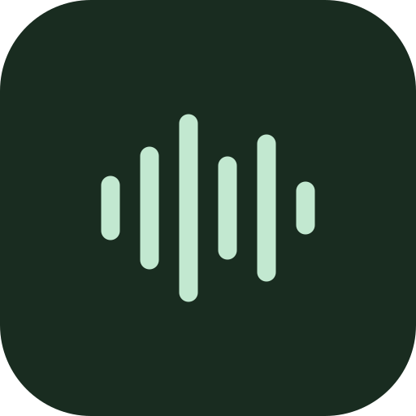
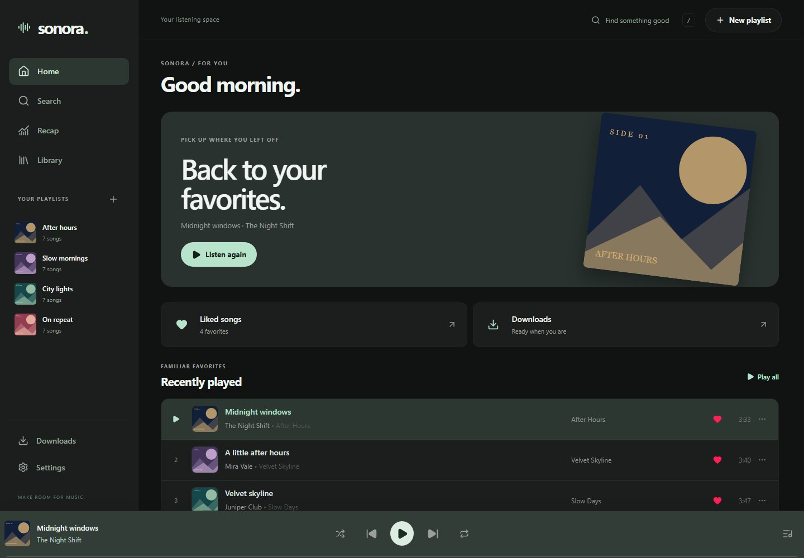
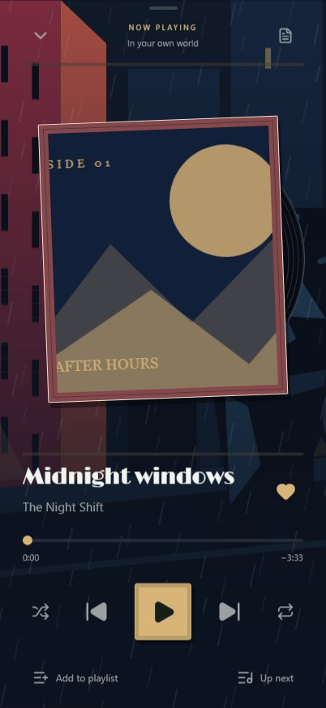
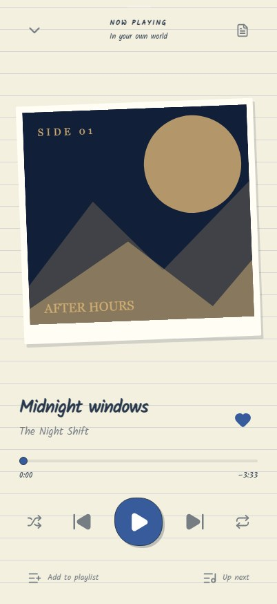
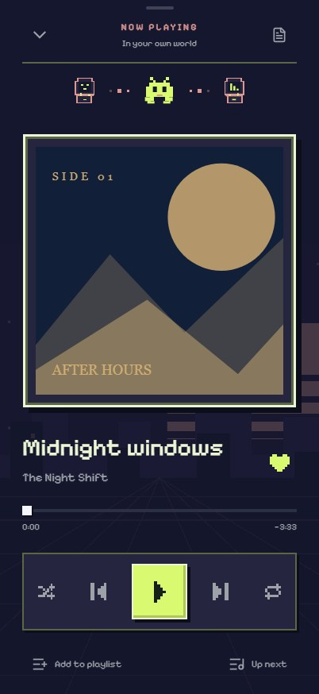
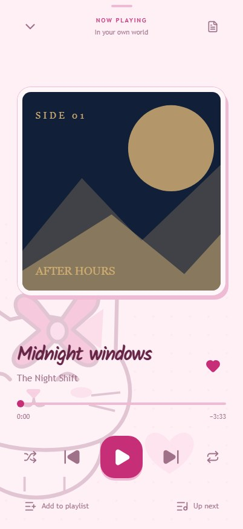
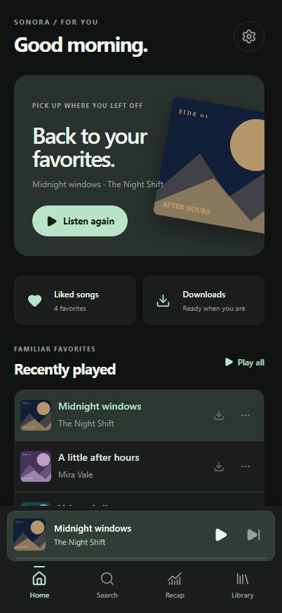
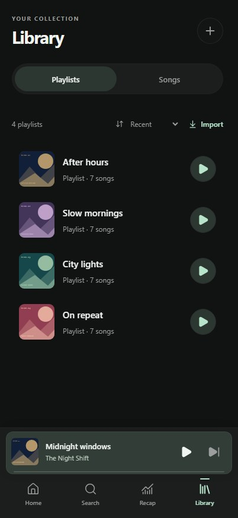
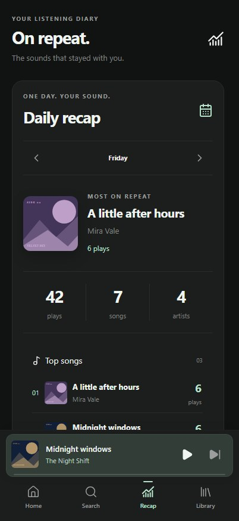

<div align="center">
  
  <h1>Sonora</h1>
  <p><strong>Your music. Your mood. Your space.</strong></p>
  <p>A self-hosted music app for discovery, personal playlists and offline listening.<br>Made for the iPhone Home Screen. Comfortable on desktop.</p>
  <p>
    <a href="https://github.com/fokee120/sonora/actions/workflows/ci.yml"></a>
    
    
    
  </p>
  <p><a href="#a-look-inside">Screenshots</a> · <a href="#run-sonora">Get started</a> · <a href="docs/SELF_HOSTING.md">Self-hosting</a> · <a href="CONTRIBUTING.md">Contributing</a></p>
</div>



## A look inside

A quiet default interface, or a completely different atmosphere. Themes change the surfaces, typography, artwork treatment and player details—not just the accent color. Add your own colors and background photo, too.

<table>
  <tr>
    <td align="center" width="25%"><br><strong>Gotham Nights</strong><br>Midnight jazz & city rain</td>
    <td align="center" width="25%"><br><strong>Notebook</strong><br>Paper, ink & handwritten notes</td>
    <td align="center" width="25%"><br><strong>Retro</strong><br>Pixels & tiny arcade companions</td>
    <td align="center" width="25%"><br><strong>Pink Energy</strong><br>Cats, bows & light or dark mode</td>
  </tr>
</table>

<table>
  <tr>
    <td align="center" width="33%"><br><strong>A home for your favorites</strong></td>
    <td align="center" width="33%"><br><strong>A library that feels yours</strong></td>
    <td align="center" width="33%"><br><strong>Your listening, remembered</strong></td>
  </tr>
</table>

<sub>Real app screenshots with a fictional demo library and original demo artwork. No personal account data is pictured. Recreate them with <a href="docs/SCREENSHOTS.md">the capture guide</a>.</sub>

## What you can do

| | |
| --- | --- |
| **Find your next favorite** | Search YouTube Music songs, artists and albums. A separate YouTube tab finds regular uploads for audio-only listening and downloads. Discover related music through YouTube Music radio. |
| **Make it your collection** | Import public Spotify and YouTube playlists, upload and crop covers, pin favorites, and sort by title, artist, album or date. Choose Custom order and hold a song title to drag it into place. |
| **Listen your way** | A persistent mini player, expanded artwork, queue, shuffle, repeat, lock-screen controls and synced lyrics when available. Swipe song rows to queue or add them to a playlist. |
| **Keep music close** | Explicit downloads work offline. Downloaded playlists automatically save newly added songs while Sonora can run. A separate, size-limited automatic cache avoids duplicating explicit downloads. |
| **Keep your library across devices** | Google sign-in syncs library data to your Sonora host. Customize your profile, follow people, search profiles and save public playlists to your library. Choose playlist, recap and history privacy separately. |
| **See your soundtrack** | Daily top songs, artists and genres, full listening history, and frozen weekly recaps released on Saturday. Past weekly editions stay in an archive. |

## Run Sonora

Use **Node.js 22 or newer**, npm, and a persistent host. Streaming needs Playwright Chromium; direct downloads need Python with `yt-dlp` and **FFmpeg** available on `PATH`. Sonora is not a static-only site or a serverless audio backend.

```sh
git clone https://github.com/fokee120/sonora.git
cd sonora
npm ci
npx playwright install chromium
```

Set up the downloader runtime:

```sh
# macOS / Linux
python3 -m venv .sonora/tools/yt-dlp-env
.sonora/tools/yt-dlp-env/bin/python -m pip install -U "yt-dlp[default]"
```

```powershell
# Windows
python -m venv .sonora/tools/yt-dlp-env
.sonora\tools\yt-dlp-env\Scripts\python.exe -m pip install -U "yt-dlp[default]"
```

Install FFmpeg using your system's package manager. The streaming bridge also requires an **unpacked Manifest V3 uBlock Origin Lite extension** in `.sonora/extensions/ublock-origin-lite` (or the path in `SONORA_ADBLOCK_EXTENSION_DIR`). Set this up before starting; the bridge refuses unprotected startup by default. See [bridge setup](docs/SELF_HOSTING.md#browser-bridge-protection).

Then build and start:

```sh
npm run build
npm start
```

Open **http://localhost:3000**. For a development preview, use `npm run dev`; development intentionally skips the installable offline service worker.

For Google sign-in, HTTPS, persistent storage, the optional Windows tray controller and troubleshooting, see **[Self-hosting Sonora](docs/SELF_HOSTING.md)**. Configuration examples are in [.env.example](.env.example).

## Install on iPhone

Serve the production build over **HTTPS**. Open it in Safari, choose **Share → Add to Home Screen**, then open the installed app online once. In Settings → Downloads, wait for offline readiness before relying on offline opening.

Downloaded audio and artwork live on that device. Signing in syncs library metadata, playlists and listening data; it does not transfer downloaded audio between devices. Different origins and Safari/Home Screen storage may have separate local data. iOS can suspend a paused app or clear its website storage.

When the Sonora server cannot be reached—even if the device still has Wi-Fi—the app enters offline mode. Songs remain visible, but only explicitly downloaded songs can play. Other rows are dimmed, and queue advancement skips them before changing the player. Automatic-cache-only songs do not count as downloads in this mode. Connectivity is rechecked on opening, returning to the app and periodically while visible.

Busy audio downloads wait in a bounded server queue. A failed download gets three automatic retries, with five seconds between attempts; cancellation stops both active work and pending retries. An error is shown only after those retries are exhausted.

## A few useful gestures

- Swipe across page backgrounds to move between Home, Search, Recap and Library. Each page keeps its scroll position.
- Tap the mini player to expand it; swipe down to close it. Swipe player artwork left or right to change tracks.
- Swipe a song right to queue it, or left to add it to a playlist. After choosing a playlist, subsequent swipes reuse it until refresh.
- Select **Custom order** in a playlist, then hold a song title to reveal reorder handles.
- Tap the playing song's title in the expanded player to return to its source playlist.

## Development & checks

```sh
npm run lint
npm run test:unit
npm run build
npx playwright install chromium webkit
npx playwright test --config playwright.custom-playlist.config.ts
npx playwright test --config playwright.row-local.config.ts tests/row-local.spec.ts
```

More focused suites cover imports, cache/download separation, lyrics, account sync, recaps, gestures and narrow iPhone layouts. See [Contributing](CONTRIBUTING.md) for the test map. Browser emulation complements physical iPhone testing; it cannot reproduce every lock-screen or background-suspension behavior.

## How it fits together

**React + TypeScript + Vite** render the app. Motion handles transitions and gestures. IndexedDB holds local library data, artwork and offline audio. An Express server provides discovery, imports and Google account persistence. A session-isolated Chromium bridge captures streaming audio; `yt-dlp` and FFmpeg prepare complete audio-only downloads. UI navigation keeps the audio engine alive.

Lyrics come from [LRCLIB](https://lrclib.net/). Public catalog and import availability depend on their upstream services; unavailable or restricted uploads can fail. Sonora does not download video files or provide a signed-in YouTube Music home feed. Use media you are authorized to access.

Bundled font licenses and artwork notes are listed in [Third-party notices](docs/THIRD_PARTY.md).

<div align="center"><sub>made by enzo</sub></div>
